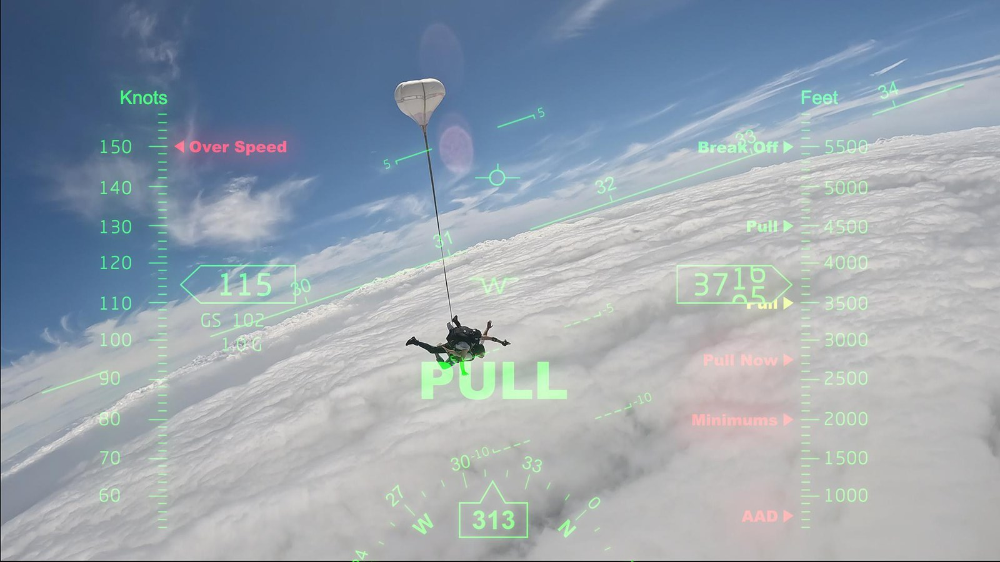
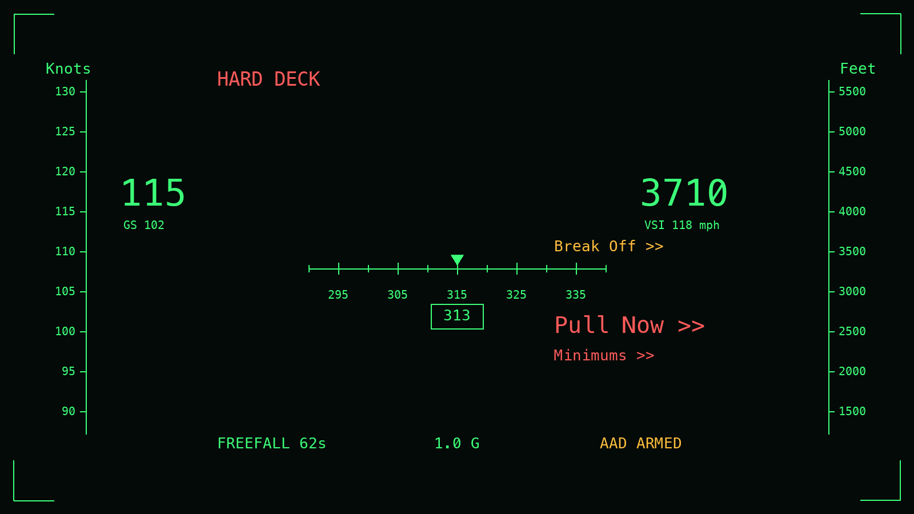
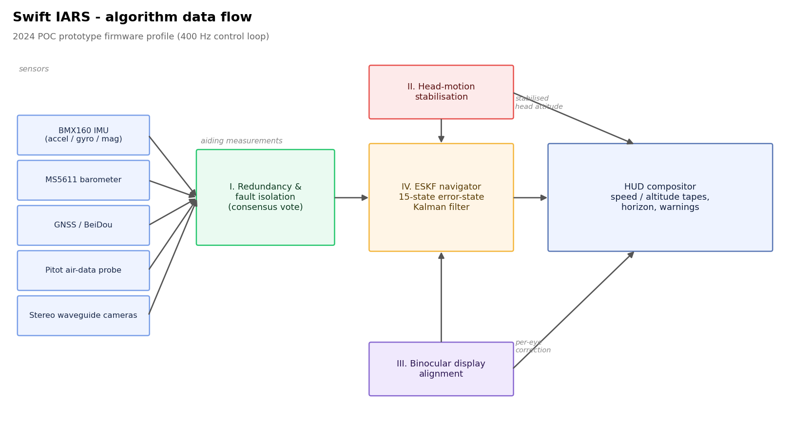
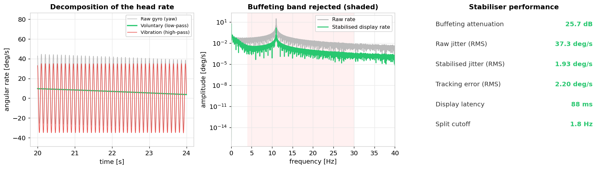
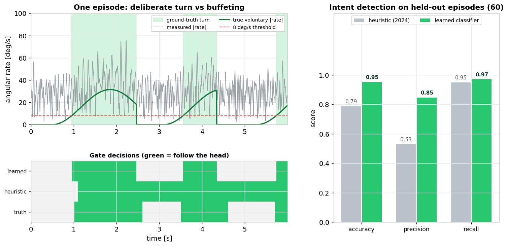
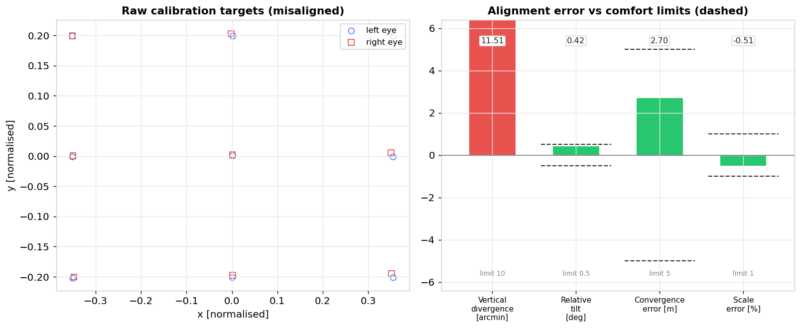
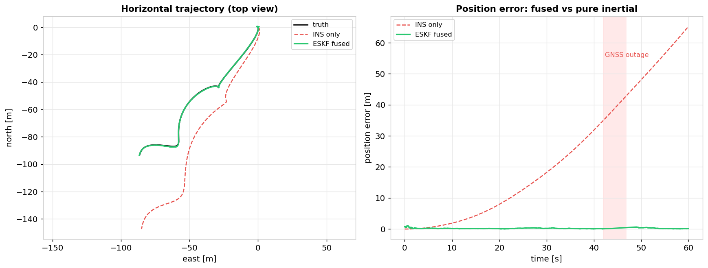

# Swift IARS — Integrated Augmented Reality System

**Algorithm core of a helmet-mounted AR head-up display for high-dynamic, hands-busy environments — skydiving, wingsuit flight, and disaster-response firefighting.**

`Python 3.9+` · `32 unit tests` · `MIT licensed` · `2024 prototype, open-sourced 2026`



*HUD symbology composited over a freefall scene — a **2024 concept render from the project, not
an in-flight photograph**; the numbers shown are illustrative, not recorded telemetry.*

---

## Overview

Swift IARS (Integrated Augmented Reality System) is a helmet-clip AR module that replaces the
four to five separate instruments a skydiver, firefighter or mountain-rescue responder currently
straps
to themselves with one fused, stabilised head-up display.

The 2024 effort produced a physical proof-of-concept: a helmet-mounted sensor head and host
board, a geometric-waveguide optical module, multilingual audio alerting, and a flight unit that
completed its air-data collection mission. The **algorithm core** — the four blocks below — is
what this repository contains: implemented in 2026 from the 2024 design and released open
source. [Provenance](#provenance-how-this-repository-was-built) states exactly which parts are
original 2024 work and which are the 2026 implementation.

This repository open-sources the **four algorithm blocks that make the display usable in
freefall**, together with a synthetic flight-data harness that lets anyone reproduce the
benchmarks without the (privacy-sensitive) real flight logs:

1. **Redundancy design & fault-tolerant sensor fusion** — four independent altitude sources,
   consensus voting, gross-error isolation and bias tracking.
2. **Head-motion stabilisation** — separating the wearer's *voluntary* head rotation from
   airflow *buffeting* so the symbology stays readable at 50 m/s.
3. **Binocular display alignment** — recovering and correcting per-eye waveguide misalignment
   (vertical divergence, relative tilt, convergence) against viewing-comfort limits.
4. **Multi-sensor SLAM / INS fusion** — a 15-state error-state Kalman filter that fuses IMU,
   barometer, GNSS/BeiDou and stereo vision into one pose, robust to GNSS outages under canopy.

> **Status.** The prototype and its flight campaign date to **2024** (business plan: 2024-07-06).
> The production firmware, the mechanical/optical design and the raw sensor logs are not public.
> What is released here is a self-contained implementation of the algorithm core that runs
> end-to-end and passes its test suite. See
> [Provenance](#provenance-how-this-repository-was-built) and
> [What is (and isn't) in this repo](#what-is-and-isnt-in-this-repo).

---

## The problem

The wearer needs correct decisions, risk avoidance and quantified skill feedback *in real time*,
without taking a hand off the controls. Today that means a bundle of single-purpose instruments:

| Domain | What people currently carry | Combination price |
|---|---|---|
| Skydiving / wingsuit (civil) | altimeter, AAD audible, FlySight GPS logger, GPS watch, ring sight | **$2,300** |
| Mountain biking (pro / hobby) | GPS cycle computer, radar tail-light | **$880** |
| Firefighting (government) | handheld thermal camera, ruggedised GPS | **$6,800** |

Every one of those is read by looking *away* from the task, and none of them knows what the
others are measuring. The value is in the fusion and the *presentation*, not in any single sensor.

---

## What we built

<p align="center">
  
  
</p>
<p align="center">
  
  
</p>

*Top row: POC hardware photographs from the 2024 project. Bottom left: the visor sample, shown
without the electrochromic lens. Bottom right: the host-board optical module — a CAD render by
the team's industrial designer, not a photograph.*

| Sub-system | 2024 design target / POC state |
|---|---|
| Display | binocular, full-colour, dual-source geometric-waveguide, >40° FOV, 1920×1080 *(design targets; the POC sample was photographed without the electrochromic lens fitted)* |
| Mounting | helmet-clip, flip-up, weight distributed through the helmet shell |
| Compute | on-helmet MCU + sensor head (no external phone or pack) |
| Sensors | BMX160 IMU (accel + gyro + magnetometer), MS5611 barometer, GNSS/BeiDou, pitot, ambient light *(planned sensor set; the POC host board carried the IMU and barometer)* |
| Alerting | multilingual audio cues + AAD status |
| Targets | C-end extreme sports → B-end OEM (motorcycle/helmet brands) → G-end firefighting & emergency response |

The table above is the **2024 design target and the state of the POC hardware**, not a measured
production specification. The stereo visual aid used by the navigator below is an addition made
for this open-source version: the 2024 sensor plan contained no cameras, but a pose that survives
GNSS loss under canopy needs a non-GNSS reference.

The display layer the wearer actually sees:

<p align="center">
  
</p>

---

## System architecture



Sensor streams feed the redundancy block, which produces the aiding measurements for the ESKF
navigator. The navigator's pose drives the HUD compositor, which is *separately* stabilised in
the head frame and *separately* corrected for binocular alignment — three concerns that consumer
stacks usually conflate, and the reason the symbology is designed to survive freefall here.

---

## The four algorithm cores

### I. Redundancy design & fault-tolerant fusion

Four independent estimates of height — barometric, GNSS, baro-aided inertial, and pitot-derived —
none of which is trustworthy alone. The barometer lags a deployment, GNSS freezes under canopy,
the inertial channel diverges as ½·a·t², and the pitot probe is unreadable below ~10 m/s.

The block runs **consensus clustering**: two sources are *compatible* when they agree within
`4.5·√(σᵢ² + σⱼ²)`; the largest mutually-compatible group is the consensus and the rest are
isolated. Surviving samples are then combined by inverse-variance weights while an EWMA tracks
per-source bias, so a mildly biased instrument is down-weighted rather than discarded.


*With a deliberately frozen GNSS channel and a slowly drifting barometer injected into the
synthetic harness, the fused estimate holds **1.57 m RMS** (5.47 m max) against truth, and no
sample is ever wrongly flagged as degraded. Simulation result.*

→ [`iars/redundancy/fusion.py`](iars/redundancy/fusion.py) · tests: [`tests/test_redundancy.py`](tests/test_redundancy.py)

### II. Head-motion stabilisation

A wearer's head moves for two reasons at once: a deliberate turn (slow, sustained, <2 Hz) and
airflow buffeting (4–30 Hz). A naive "follow the head" HUD follows both and smears into a blur.
The stabiliser splits the 3-axis gyro rate with complementary biquad filters, runs a
hysteresis **intent detector**, and regenerates the display attitude from

```
ω_display = follow_intent · ω_voluntary  +  g_vib · ω_vibration ,   g_vib = 0.05
```

so the symbology tracks intent, rejects the buffet, and freezes rather than integrating noise
when the wearer is only being shaken.



*On a synthetic freefall profile the buffeting band is attenuated **25.7 dB**, RMS jitter drops
from **37.3 to 1.9 deg/s**, and voluntary tracking stays within 2.2 deg/s RMS.*

#### Learned intent gate (2026 addition)

The threshold/hysteresis gate above is replaced, optionally, by a small learned classifier
([`iars/stabilization/intent.py`](iars/stabilization/intent.py)): eight windowed gyro features —
voluntary-band magnitude, buffeting RMS, their ratio, spectral centroid, zero-crossing rate,
autocorrelation peak in the 5–25 Hz band — fed to a logistic regression small enough for the
400 Hz loop. It is trained on episodes in which the voluntary and buffeting components are known
**by construction** ([`iars/sensors/intent_dataset.py`](iars/sensors/intent_dataset.py)), so the
accuracy comparison is against generator ground truth, not against the heuristic's own output.



*On 60 held-out episodes the learned gate lifts accuracy from **0.79 to 0.95** and precision from
**0.53 to 0.85**: the fixed threshold over-triggers whenever a hard buffet leaks low-frequency
energy through the 1.8 Hz split, which is exactly the failure the classifier is trained to
separate.*

→ [`iars/stabilization/head_motion.py`](iars/stabilization/head_motion.py) · [`iars/stabilization/intent.py`](iars/stabilization/intent.py) · tests: [`tests/test_stabilization.py`](tests/test_stabilization.py), [`tests/test_intent.py`](tests/test_intent.py)

### III. Binocular display alignment

Two waveguides, one per eye, never mount perfectly. The eye is especially sensitive to three
residuals: **vertical divergence** (arc-minutes), **relative image tilt** (degrees) and
**convergence error** (metres). The block fits a per-eye affine map from calibration
correspondences, derives those parameters, checks them against viewing-comfort limits, and
synthesises a per-eye correction the compositor bakes in.



*The demo rig is deliberately misaligned: an **11.5 arcmin** vertical divergence (limit 10) and a
**0.42°** relative tilt (limit 0.5) are recovered and flagged, and the correction drives the
inter-eye disparity from **8.30 px to 0.80 px** (the calibration noise floor).*

→ [`iars/stereo/alignment.py`](iars/stereo/alignment.py) · tests: [`tests/test_stereo.py`](tests/test_stereo.py)

### IV. Multi-sensor SLAM / INS fusion

A 15-state error-state Kalman filter on `[p, v, q, b_a, b_g]`, fed by IMU pre-integration at
400 Hz, barometric altitude, GNSS position/velocity, and a stereo visual pose. Working in the
*error* state keeps the attitude error small and linear, so the covariance stays valid through
50 m/s freefall and violent buffeting. Every measurement passes a **chi-square innovation gate**
first, which is what makes the fusion survive the GNSS outage under canopy.

```
δx ← F δx + G w                       (IMU propagation, 400 Hz)
K   = P Hᵀ (H P Hᵀ + R)⁻¹             (gain)
δx  = K r ,  rᵀ S⁻¹ r < γ²            (gated innovation update)
X   ⊕ δx,  P ← (I−KH) P (I−KH)ᵀ + K R Kᵀ   (Joseph form injection)
```



*Fusing vision, GNSS and baro, the filter tracks truth to **0.25 m RMS** (0.13 m final error)
through the whole 60 s synthetic profile — including a 7 s GNSS outage — where a pure inertial
solution has already diverged to **31 m RMS**. Simulation result.*

→ [`iars/slam/eskf.py`](iars/slam/eskf.py) · [`iars/slam/frames.py`](iars/slam/frames.py) · tests: [`tests/test_eskf.py`](tests/test_eskf.py)

<details>
<summary><b>Benchmark summary (reproduce with <code>make demo</code>)</b></summary>

| Block | Metric | Value |
|---|---|---|
| I. Redundancy | fused altitude RMSE vs truth | 1.57 m |
| I. Redundancy | max error under 2 injected faults | 5.47 m |
| I. Redundancy | samples wrongly flagged degraded | 0 % |
| II. Stabilisation | buffeting attenuation | 25.7 dB |
| II. Stabilisation | jitter RMS (raw → stabilised) | 37.3 → 1.9 deg/s |
| II. Stabilisation | display latency | 88 ms |
| II. Intent gate | intent accuracy (heuristic → learned) | 0.79 → 0.95 |
| II. Intent gate | intent precision (heuristic → learned) | 0.53 → 0.85 |
| III. Stereo | vertical divergence detected | 11.5 arcmin (limit 10) |
| III. Stereo | inter-eye disparity (raw → corrected) | 8.30 → 0.80 px |
| IV. Navigation | ESKF position RMSE | 0.25 m |
| IV. Navigation | pure-INS position RMSE | 30.97 m |

Every figure is produced by the synthetic harness ([`iars/sensors/simulator.py`](iars/sensors/simulator.py),
[`iars/sensors/intent_dataset.py`](iars/sensors/intent_dataset.py)) on a laptop CPU. **These are
simulation results, not flight-tested specifications** — see
[Provenance](#provenance-how-this-repository-was-built) for why that distinction matters.
</details>

---

## Provenance: how this repository was built

A portfolio repository should be explicit about what it is, so this section is deliberately
blunt.

**Original 2024 work — and who did what.** Swift IARS was a 2024 startup project. **My role was
project lead and the embedded/algorithm work**: the product concept, the requirement and market
analysis, the decomposition of the display problem into algorithm blocks, the viewing-comfort and
anti-shake acceptance criteria, and the algorithm design steps (separating voluntary head
rotation from buffeting, defining anti-shake acceptance metrics, cancelling jitter, then
following head rotation). The **industrial and mechanical design was
contributed by an industrial designer on the team**, and the flight-test campaign and air-data
collection were a **team effort**. The 2024 material names three core algorithms — redundancy
design, anti-shake, and binocular imaging — and marks them "substantially developed"; the flight
unit completed its air-data collection mission explicitly so the recorded data could drive the
final algorithm design.

**What is written in 2026.** This repository. The original 2024 source is not public and is not
included here; the code, tests, figures and documentation in this repo are my 2026 work, written
to open-source the algorithm core. The real flight logs are personal telemetry and are not
published, so the repository ships a synthetic harness that reproduces the salient statistics
instead. The commit dates are set to the 2024 prototype timeline rather than the 2026 authoring
date, so the history reads against the milestones above — the code was authored in 2026.

**AI assistance.** The 2026 implementation was drafted with AI coding assistance and then
reviewed, tested and tuned. The algorithm choices, acceptance criteria, architecture and
validation are the author's; the code was not accepted without being run and checked (the test
suite is the evidence). This is stated openly because the alternative — letting a reader assume
either "fully hand-written in 2024" or "fully machine-generated" — would both be false.

**Residual uncertainty.** Because the implementation was not developed against the original
logs, every number in this README is a **simulation result from the synthetic harness**, not
flight-tested performance. Real buffeting spectra, real GNSS-outage statistics and the actual
waveguide-to-waveguide alignment spreads are modelled assumptions. The constants in
[`iars/config.py`](iars/config.py) are the author's estimates, not bench-calibrated values, and
should be re-tuned before any hardware use.

### Engineering decisions worth calling out

**Why an error-state Kalman filter instead of an EKF on the quaternion.** Three reasons, all of
which matter in freefall. (1) *Linearisation validity*: the body rate is large and the
accelerations are violent, so a filter that linearises about the full attitude accumulates error
whenever the attitude correction is big (a GNSS re-acquisition after canopy transit is exactly
that). An ESKF propagates the nominal state non-linearly and estimates only the *error*, which
stays near zero, so the linearisation remains valid; the reset after each update keeps it there.
(2) *Manifold correctness*: the error is injected as `q ← q ⊗ Exp(δθ)`, which is exact on SO(3)
and avoids the normalisation drift a naive quaternion EKF develops. (3) *Gating*: the innovation
gate is applied to the error state, which is what lets the filter reject the first fix after a
7 s outage rather than being yanked by it.

**Why the display stabilisation is decoupled from SLAM.** The two loops have incompatible
requirements. The display loop must run at IMU rate with bounded latency and must never stall;
the navigator's vision updates arrive at ~30 Hz and can drop out entirely (featureless sky,
smoke). If the symbology were driven by the SLAM pose, a single tracking dropout or the canopy
GNSS outage would freeze or jerk the horizon — the one thing the wearer is relying on. Decoupled,
the symbology is regenerated from the IMU alone at all times and the navigator only supplies the
annotation layer (where things are). The consequence is a deliberate degradation hierarchy: a
pose dropout costs annotations, never the horizon.

**Why explicit redundancy voting sits outside the filter.** The filter could ingest all four
altitude sources directly and let the covariance sort them out, but a covariance cannot express
"the GNSS channel is stuck and I know it". Explicit clustering gives an isolable fault, a named
culprit and a degraded-mode flag the HUD can act on; the filter then sees one clean measurement
with a known variance.

**Why the acceptance criteria are thresholds and not learned objectives.** Binocular comfort
limits (10 arcmin vertical divergence, 0.5° relative tilt) and the ≤100 ms display-latency budget
are human-factors constraints, not tunable losses. Encoding them as pass/fail criteria keeps the
tuning loop honest: a change either meets the limit or it does not.

---

## How this differs from existing products and research

**Versus consumer AR sports eyewear** (Everysight Raptor-class, bike HUD glasses): those are
vision-centric, single-eye, and assume a rider who is upright, slow and never upside-down. IARS
is **inertial-centric**: the pose and the display stabilisation are driven by the IMU, so the
display does not lose lock when the scene is a featureless sky or a smoke-filled room. It is
binocular (depth-correct) rather than monocular, and it is designed for the sensor **and** the
display to live on the helmet instead of tethering to a phone.

**Versus industrial / enterprise HMDs** (Vuzix-, Rokid-class optical modules): those ship the
*display* and leave the sensing, fusion and stabilisation to the integrator. The contribution
here is exactly that missing layer — the algorithms that turn a helmet full of sensors into one
usable, stable, redundant picture.

**Versus open-source SLAM / AR stacks** — the honest technical comparison:

| | Vision-centric stacks (ORB-SLAM3, VINS-Fusion, OpenVINS) | LiDAR/inertial (LIO-SAM, FAST-LIO2) | **IARS (this repo)** |
|---|---|---|---|
| Primary sensor | camera, IMU aiding | LiDAR, IMU aiding | **IMU primary, everything else aiding** |
| Failure mode drive | texture loss, motion blur, wide-baseline jumps | cost, weight, power | — |
| Targeted regime | indoor / urban, 1–2 m/s | ground vehicles | **GNSS-denied, 50 m/s, high angular rate** |
| Display concern | out of scope | out of scope | **first-class: stabilisation + binocular alignment** |
| Compute budget | desktop / embedded GPU | workstation-class | **on-helmet MCU, fixed loop** |
| Redundancy | covariance only | covariance only | **explicit channel voting + isolation** |

The design bet is that in freefall, smoke and turbulence, **robust inertial fusion with explicit
redundancy matters more than vision throughput**, and that the display-stabilisation loop should
be decoupled from SLAM so an occasional tracking dropout never blurs the symbology.

---

## Repository layout

```
iars/
  config.py                 tuning parameters (POC firmware profile, SI units)
  sensors/simulator.py      synthetic flight-data harness (no real logs are public)
  sensors/intent_dataset.py labelled episodes for the learned intent gate
  redundancy/fusion.py      I.  redundancy design & fault-tolerant fusion
  stabilization/head_motion.py  II.  head-motion separation & stabilisation
  stabilization/intent.py   learned intent gate (features + logistic regression)
  stabilization/intent_weights.json  trained weights (checked in, ~2 KB)
  stereo/alignment.py       III. binocular display alignment
  slam/frames.py            rigid-body math (quaternions, SO(3) exp/log)
  slam/eskf.py              IV. 15-state ESKF navigator
  telemetry/hud.py          HUD compositor / symbology renderer
  pipeline.py               end-to-end run across all four blocks
tests/                      32 unit tests, one module per algorithm block
tools/generate_figures.py   regenerates every figure in this README
tools/run_demo.py           runs the pipeline and prints the benchmark table
tools/train_intent.py       trains / evaluates the learned intent gate
docs/ALGORITHMS.md          derivation notes and design rationale
```

## Quick start

```bash
python -m pip install -e ".[dev]"   # or: pip install -r requirements.txt
python -m pytest -q                 # run the test suite (all tests pass)
python tools/run_demo.py            # print the benchmark summary
python tools/train_intent.py        # retrain the learned intent gate
python tools/generate_figures.py    # regenerate the figures in docs/assets/
```

No flight hardware is required — the harness synthesises a 60 s profile (exit, freefall,
deployment, canopy) with realistic buffeting, GNSS outage and sensor noise.

## Roadmap

- [x] Learned intent classifier to replace the heuristic hysteresis gate *(done — 0.79 → 0.95 accuracy on held-out episodes)*
- [ ] Quantise the intent gate and benchmark it inside the 400 Hz MCU loop
- [ ] ROS 2 / micro-ROS bridge for the on-helmet firmware loop
- [ ] Tight visual-inertial coupling (feature-level) in place of the loose pose update
- [ ] Public benchmark protocol and a second synthetic profile (smoke diving, motorcycle)

## What is (and isn't) in this repo

**In:** the four algorithm blocks, the learned intent gate and its checked-in weights, the
rigid-body/EKF math, both synthetic datasets, the HUD compositor, the figure generator, and the
test suite — all runnable and passing.

**Not in:** production firmware, PCB/optical/mechanical design files, real flight logs, and
business-plan material. The simulator exists precisely so the algorithms can be reproduced
without the private data.

## Author & license

**Project lead: Zixin Jia.** Swift IARS was a 2024 startup project; the 2026 algorithm
implementation and this open-source release are mine. MIT licensed — see [`LICENSE`](LICENSE).
