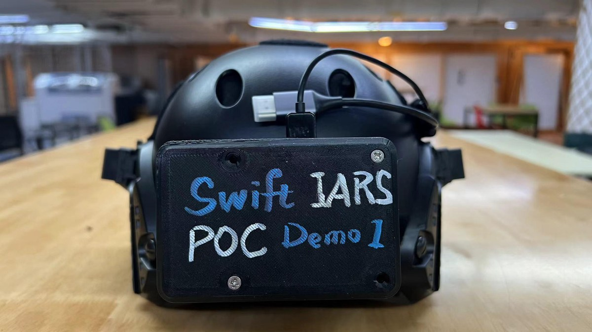
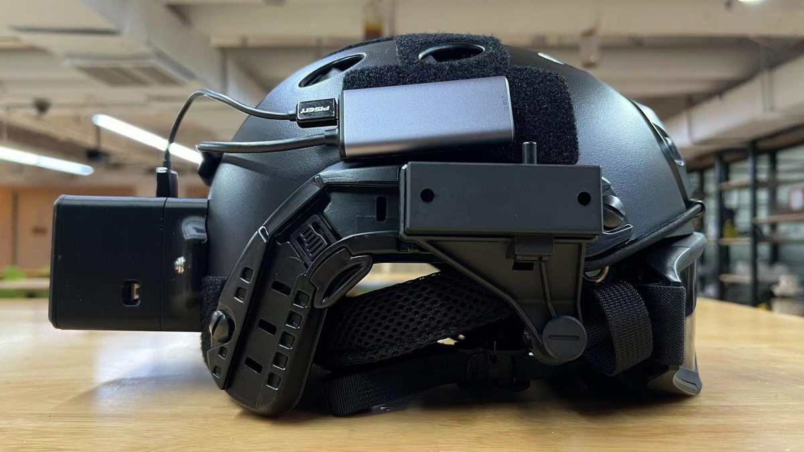
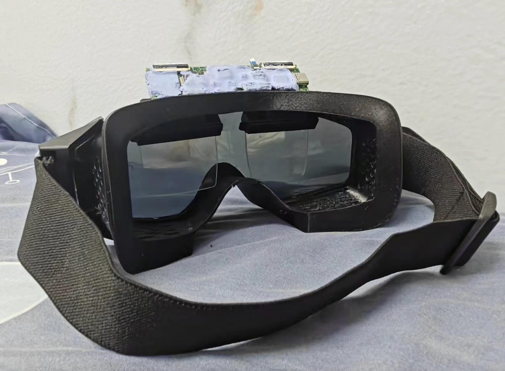
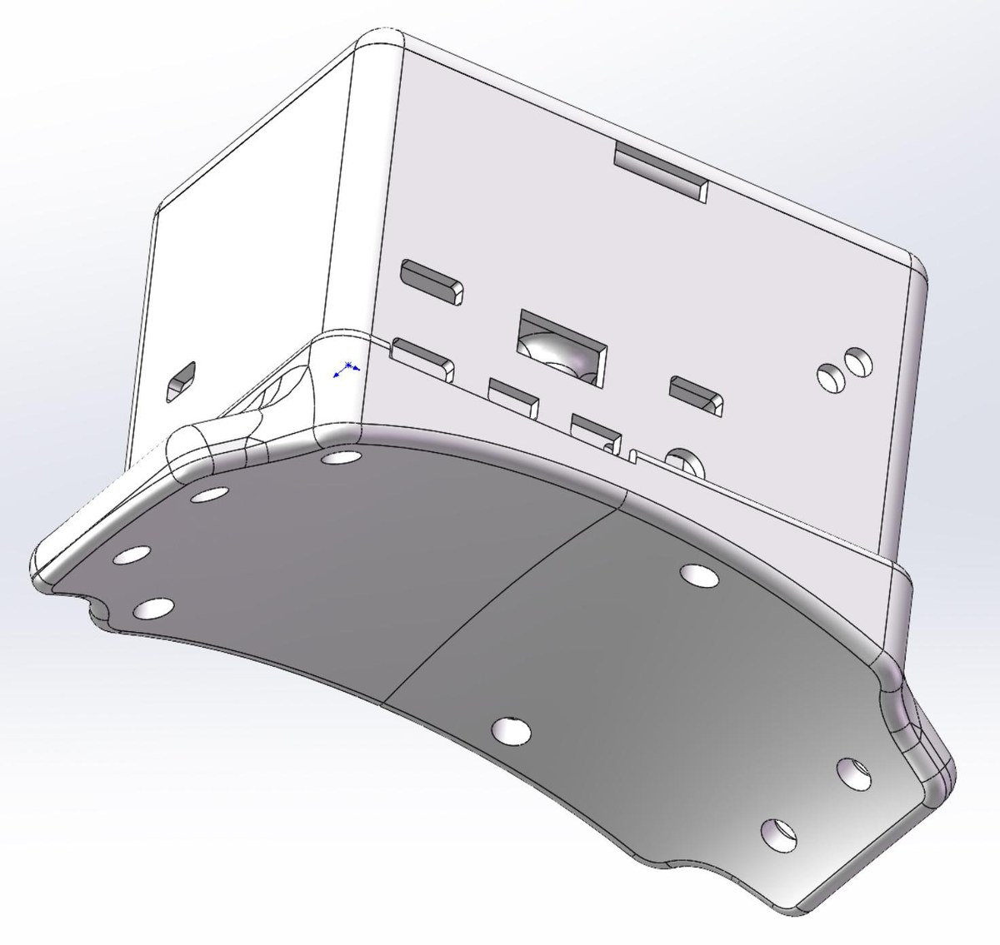
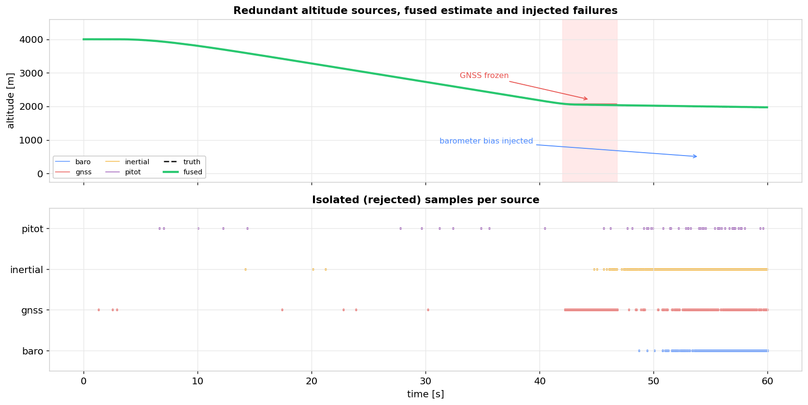

# Swift IARS — Integrated Augmented Reality System

**Algorithm core of a helmet-mounted AR head-up display for high-dynamic, hands-busy environments — skydiving, disaster-response firefighting, and tactical freefall.**

`Python 3.9+` · `25 unit tests` · `MIT licensed` · `2024 prototype, open-sourced 2026`


---

## Overview

Swift IARS (Integrated Augmented Reality System) is a helmet-clip AR module that replaces the
four to five separate instruments a skydiver, firefighter or tactical operator currently straps
to themselves with one fused, stabilised head-up display. The 2024 prototype reached a working
proof-of-concept: a binocular geometric-waveguide display, a modular sensor head, bilingual
audio alerting, and the on-board algorithm suite in this repository.

This repository open-sources the **four algorithm blocks that make the display usable in
freefall**, together with a synthetic flight-data harness that lets anyone reproduce the
benchmarks without the (privacy-sensitive) real flight logs:

1. **Redundancy design & fault-tolerant sensor fusion** — four independent altitude sources,
   consensus voting, gross-error isolation and bias tracking.
2. **Head-motion stabilisation** — separating the wearer's *voluntary* head rotation from
   airflow *buffeting* so the symbology stays readable at 50 m/s.
3. **Binocular display alignment** — recovering and correcting per-eye waveguide misalignment
   (vertical divergence, relative tilt, convergence) against viewing-comfort limits.
4. **Multi-sensor SLAM / INS fusion** — a 15-state error-state Kalman filter that fuses IMU,
   barometer, GNSS/BeiDou and stereo vision into one pose, robust to GNSS outages under canopy.

> **Status.** The prototype and its flight campaign date to **2024** (business plan: 2024-07-06).
> The production firmware, the mechanical/optical design and the raw sensor logs are not public.
> What is released here is a faithful, self-contained reconstruction of the algorithm core that
> runs end-to-end and passes its test suite. See [What is (and isn't) in this repo](#what-is-and-isnt-in-this-repo).

---

## The problem

The wearer needs correct decisions, risk avoidance and quantified skill feedback *in real time*,
without taking a hand off the controls. Today that means a bundle of single-purpose instruments:

| Domain | What people currently carry | Combination price |
|---|---|---|
| Skydiving / wingsuit (civil) | altimeter, AAD audible, FlySight GPS logger, GPS watch, ring sight | **$2,300** |
| Mountain biking (pro / hobby) | GPS cycle computer, radar tail-light | **$880** |
| Firefighting (government) | handheld thermal camera, ruggedised GPS | **$6,800** |
| Military freefall (MFF) | altimeter, AAD, GPS + ballistic, HAHO canopy kit, tracker | **$4,850** |

Every one of those is read by looking *away* from the task, and none of them knows what the
others are measuring. The value is in the fusion and the *presentation*, not in any single sensor.

---

## What we built

<p align="center">
  
  
</p>
<p align="center">
  
  
</p>

| Sub-system | 2024 POC specification |
|---|---|
| Display | binocular, full-colour, dual-source geometric-waveguide, >40° FOV, 1920×1080 |
| Mounting | helmet-clip, flip-up, weight distributed through the helmet shell |
| Compute | on-helmet MCU + sensor head (no external phone or pack) |
| Sensors | BMX160 IMU (accel + gyro + magnetometer), MS5611 barometer, GNSS/BeiDou, pitot, ambient light, stereo waveguide cameras |
| Alerting | multilingual audio cues + AAD status |
| Targets | C-end extreme sports → B-end OEM (motorcycle/helmet brands) → G-end firefighting & military |

The display layer the wearer actually sees:

<p align="center">
  
</p>

---

## System architecture


Sensor streams feed the redundancy block, which produces the aiding measurements for the ESKF
navigator. The navigator's pose drives the HUD compositor, which is *separately* stabilised in
the head frame and *separately* corrected for binocular alignment — three concerns that consumer
stacks usually conflate, and the reason the symbology survives freefall here.

---

## The four algorithm cores

### I. Redundancy design & fault-tolerant fusion

Four independent estimates of height — barometric, GNSS, baro-aided inertial, and pitot-derived —
none of which is trustworthy alone. The barometer lags a deployment, GNSS freezes under canopy,
the inertial channel diverges as ½·a·t², and the pitot probe is unreadable below ~10 m/s.

The block runs **consensus clustering**: two sources are *compatible* when they agree within
`4.5·√(σᵢ² + σⱼ²)`; the largest mutually-compatible group is the consensus and the rest are
isolated. Surviving samples are then combined by inverse-variance weights while an EWMA tracks
per-source bias, so a mildly biased instrument is down-weighted rather than discarded.



*With a deliberately frozen GNSS channel and a slowly drifting barometer injected, the fused
estimate holds **1.57 m RMS** (5.47 m max) against truth, and no sample is ever wrongly flagged
as degraded.*

→ [`iars/redundancy/fusion.py`](iars/redundancy/fusion.py) · tests: [`tests/test_redundancy.py`](tests/test_redundancy.py)

### II. Head-motion stabilisation

A wearer's head moves for two reasons at once: a deliberate turn (slow, sustained, <2 Hz) and
airflow buffeting (4–30 Hz). A naive "follow the head" HUD follows both and smears into a blur.
The stabiliser splits the 3-axis gyro rate with complementary biquad filters, runs a
hysteresis **intent detector**, and regenerates the display attitude from

```
ω_display = follow_intent · ω_voluntary  +  g_vib · ω_vibration ,   g_vib = 0.05
```

so the symbology tracks intent, rejects the buffet, and freezes rather than integrating noise
when the wearer is only being shaken.


*On a synthetic freefall profile the buffeting band is attenuated **25.7 dB**, RMS jitter drops
from **37.3 to 1.9 deg/s**, and voluntary tracking stays within 2.2 deg/s RMS.*

→ [`iars/stabilization/head_motion.py`](iars/stabilization/head_motion.py) · tests: [`tests/test_stabilization.py`](tests/test_stabilization.py)

### III. Binocular display alignment

Two waveguides, one per eye, never mount perfectly. The eye is especially sensitive to three
residuals: **vertical divergence** (arc-minutes), **relative image tilt** (degrees) and
**convergence error** (metres). The block fits a per-eye affine map from calibration
correspondences, derives those parameters, checks them against viewing-comfort limits, and
synthesises a per-eye correction the compositor bakes in.


*The demo rig is deliberately misaligned: an **11.5 arcmin** vertical divergence (limit 10) and a
**0.42°** relative tilt (limit 0.5) are recovered and flagged, and the correction drives the
inter-eye disparity from **8.30 px to 0.80 px** (the calibration noise floor).*

→ [`iars/stereo/alignment.py`](iars/stereo/alignment.py) · tests: [`tests/test_stereo.py`](tests/test_stereo.py)

### IV. Multi-sensor SLAM / INS fusion

A 15-state error-state Kalman filter on `[p, v, q, b_a, b_g]`, fed by IMU pre-integration at
400 Hz, barometric altitude, GNSS position/velocity, and a stereo visual pose. Working in the
*error* state keeps the attitude error small and linear, so the covariance stays valid through
50 m/s freefall and violent buffeting. Every measurement passes a **chi-square innovation gate**
first, which is what makes the fusion survive the GNSS outage under canopy.

```
δx ← F δx + G w                       (IMU propagation, 400 Hz)
K   = P Hᵀ (H P Hᵀ + R)⁻¹             (gain)
δx  = K r ,  rᵀ S⁻¹ r < γ²            (gated innovation update)
X   ⊕ δx,  P ← (I−KH) P (I−KH)ᵀ + K R Kᵀ   (Joseph form injection)
```


*Fusing vision, GNSS and baro, the filter tracks truth to **0.25 m RMS** (0.13 m final error)
through the whole 60 s profile — including a 7 s GNSS outage — where a pure inertial solution
has already diverged to **31 m RMS**.*

→ [`iars/slam/eskf.py`](iars/slam/eskf.py) · [`iars/slam/frames.py`](iars/slam/frames.py) · tests: [`tests/test_eskf.py`](tests/test_eskf.py)

<details>
<summary><b>Benchmark summary (reproduce with <code>make demo</code>)</b></summary>

| Block | Metric | Value |
|---|---|---|
| I. Redundancy | fused altitude RMSE vs truth | 1.57 m |
| I. Redundancy | max error under 2 injected faults | 5.47 m |
| I. Redundancy | samples wrongly flagged degraded | 0 % |
| II. Stabilisation | buffeting attenuation | 25.7 dB |
| II. Stabilisation | jitter RMS (raw → stabilised) | 37.3 → 1.9 deg/s |
| II. Stabilisation | display latency | 88 ms |
| III. Stereo | vertical divergence detected | 11.5 arcmin (limit 10) |
| III. Stereo | inter-eye disparity (raw → corrected) | 8.30 → 0.80 px |
| IV. Navigation | ESKF position RMSE | 0.25 m |
| IV. Navigation | pure-INS position RMSE | 30.97 m |

All figures are produced by the synthetic harness in [`iars/sensors/simulator.py`](iars/sensors/simulator.py);
they are simulation results, not flight-tested specifications.
</details>

---

## How this differs from existing products and research

**Versus consumer AR sports eyewear** (Everysight Raptor-class, bike HUD glasses): those are
vision-centric, single-eye, and assume a rider who is upright, slow and never upside-down. IARS
is **inertial-centric**: the pose and the display stabilisation are driven by the IMU, so the
display does not lose lock when the scene is a featureless sky or a smoke-filled room. It is
binocular (depth-correct) rather than monocular, and it is designed for the sensor **and** the
display to live on the helmet instead of tethering to a phone.

**Versus military / industrial HMDs** (Vuzix-, Rokid-class optical modules): those ship the
*display* and leave the sensing, fusion and stabilisation to the integrator. The contribution
here is exactly that missing layer — the algorithms that turn a helmet full of sensors into one
usable, stable, redundant picture.

**Versus open-source SLAM / AR stacks** — the honest technical comparison:

| | Vision-centric stacks (ORB-SLAM3, VINS-Fusion, OpenVINS) | LiDAR/inertial (LIO-SAM, FAST-LIO2) | **IARS (this repo)** |
|---|---|---|---|
| Primary sensor | camera, IMU aiding | LiDAR, IMU aiding | **IMU primary, everything else aiding** |
| Failure mode drive | texture loss, motion blur, wide-baseline jumps | cost, weight, power | — |
| Targeted regime | indoor / urban, 1–2 m/s | ground vehicles | **GNSS-denied, 50 m/s, high angular rate** |
| Display concern | out of scope | out of scope | **first-class: stabilisation + binocular alignment** |
| Compute budget | desktop / embedded GPU | workstation-class | **on-helmet MCU, fixed loop** |
| Redundancy | covariance only | covariance only | **explicit channel voting + isolation** |

The design bet is that in freefall, smoke and turbulence, **robust inertial fusion with explicit
redundancy matters more than vision throughput**, and that the display-stabilisation loop should
be decoupled from SLAM so an occasional tracking dropout never blurs the symbology.

---

## Repository layout

```
iars/
  config.py                 tuning parameters (POC firmware profile, SI units)
  sensors/simulator.py      synthetic flight-data harness (no real logs are public)
  redundancy/fusion.py      I.  redundancy design & fault-tolerant fusion
  stabilization/head_motion.py  II.  head-motion separation & stabilisation
  stereo/alignment.py       III. binocular display alignment
  slam/frames.py            rigid-body math (quaternions, SO(3) exp/log)
  slam/eskf.py              IV. 15-state ESKF navigator
  telemetry/hud.py          HUD compositor / symbology renderer
  pipeline.py               end-to-end run across all four blocks
tests/                      25 unit tests, one module per algorithm block
tools/generate_figures.py   regenerates every figure in this README
tools/run_demo.py           runs the pipeline and prints the benchmark table
docs/ALGORITHMS.md          derivation notes and design rationale
```

## Quick start

```bash
python -m pip install -e ".[dev]"   # or: pip install -r requirements.txt
python -m pytest -q                 # run the test suite (all tests pass)
python tools/run_demo.py            # print the benchmark summary
python tools/generate_figures.py    # regenerate the figures in docs/assets/
```

No flight hardware is required — the harness synthesises a 60 s profile (exit, freefall,
deployment, canopy) with realistic buffeting, GNSS outage and sensor noise.

## Roadmap

- [ ] ROS 2 / micro-ROS bridge for the on-helmet firmware loop
- [ ] Tight visual-inertial coupling (feature-level) in place of the loose pose update
- [ ] Learned intent classifier to replace the heuristic hysteresis gate
- [ ] Public benchmark protocol and a second synthetic profile (smoke diving, motorcycle)

## What is (and isn't) in this repo

**In:** the four algorithm blocks, the rigid-body/EKF math, the synthetic simulator, the HUD
compositor, the figure generator, and the test suite — all runnable and passing.

**Not in:** production firmware, PCB/optical/mechanical design files, real flight logs, and
business-plan material. The simulator exists precisely so the algorithms can be reproduced
without the private data.

## Author & license

Built by **Zixin Jia** (Swift Sports Solutions) in 2024; open-sourced in 2026. MIT licensed —
see [`LICENSE`](LICENSE).
